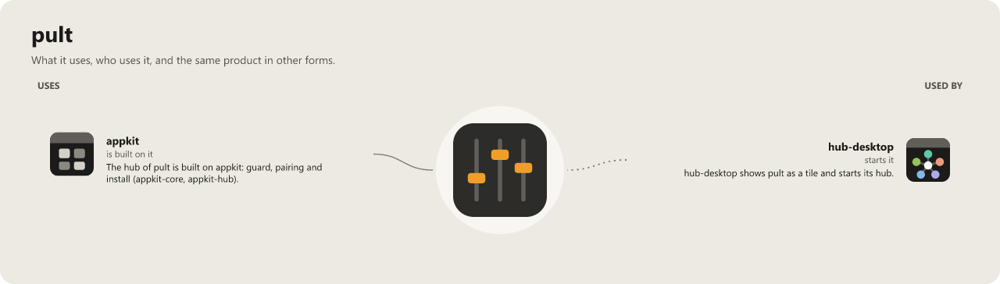

# pult

[](https://wkdsteve.github.io/wkd/apps/pult/)

Ein eigener virtueller Audio-Mixer für Windows, in Rust: Ton von Programmen, Mikrofon und Interface-Eingängen mischen und auf Hardware- und virtuelle Ausgänge verteilen. Der Name kommt vom *Mischpult*. pult ist die Schwester-App von [takt](https://github.com/WKDSteve/takt), der Medien-Suite: zwei eigenständige Programme, und läuft pult, kann takt sich später damit verbinden.

> **Status (2026-11-06): Alpha. Stufen 1, 2 und 5a bis 5e fertig, Stufe 3 (natives Fenster) bis auf den Handtest, Stufe 4 (DSP) im Bau.** Ein Fenster und ein Kommandozeilen-Programm, das Eingangsgeräte mischt und auf einen oder mehrere Ausgänge (Busse) spielt, zum Beispiel alle Programme über ein virtuelles Kabel auf das Scarlett 2i2 und weiter zum Verstärker; am echten Aufbau 2 Stunden ohne Aussetzer gelaufen. Welcher Eingang auf welchen Bus geht, mit Gain, Mute und Pan, steht in einem Profil (TOML); während des Laufs lassen sich die Regler per Befehl ändern und als Profil speichern. Pegel, Aussetzer und die Korrektur der Takt-Drift erscheinen live in der Konsole; jeder Eingang läuft durch einen adaptiven Resampler, der dem Takt des Ausgangs folgt. Ein abgestecktes Gerät beendet den Lauf nicht: der Rest spielt weiter, das Gerät wird wieder aufgenommen, sobald es zurück ist. Auch der Ton eines einzelnen Programms kann ein Eingang sein (Prozess-Loopback). Geräte dürfen verschiedene Abtastraten haben. Einrichtung und Bedienung: [docs/USAGE.md](docs/USAGE.md).

**English.** pult is a personal virtual audio mixer for Windows written in Rust (a window and a command line router that mix input devices and programs onto one or more output buses, configured by a TOML profile). A personal, non-commercial project; the documentation is in German on purpose, code and commit messages are in English.

## Was geht schon

| Funktion | Stand |
|---|---|
| Geräte auflisten (`pult devices`) | fertig |
| Eingänge mischen und auf einen Ausgang spielen (`pult run --from … --to …`), Gain je Eingang | fertig |
| Mehrere Busse (Ausgänge) mit Routing-Matrix, Gain/Mute/Pan je Eingang, Gain/Mute je Bus, als Profil-Datei (`pult run --profile`) | fertig |
| EQ und Limiter je Eingang, EQ wahlweise vor oder hinter Gate und Kompressor (`eq 2 3 gain -4`, `eq 2 pre`, `limit 2 on`; im Tab EQ unter den Bussen) | fertig |
| Kanalzug je Eingang: Polarität, Hoch-/Tiefpass, Verzögerung, Stereobreite (`hpf 2 80`, `polarity 2 on`, HPF/LPF/Ø im Fenster) | fertig |
| Ducking: ein Eingang wird leiser, solange ein anderer klingt (`duck 1 by 2`, `duck_by = 2` im Profil) | fertig; im Fenster in der Ansicht EQ unter jedem Eingang |
| Bus-Kompressor auf der Summe mit Parallel-Mix und Sidechain-Hochpass (`comp A1 3`, `comp A1 mix 50`, Spalte COMPRESSOR in der EQ-Ansicht) | fertig |
| Multiband-Kompressor je Bus: drei Bänder mit Linkwitz-Riley-Weichen, je Band ein Regler (`mb A1 low 4`, Spalte MULTIBAND in der EQ-Ansicht) | fertig |
| Loudness je Bus nach EBU R128 (LUFS momentary/short-term/integrated, LRA, True Peak), unter dem Bus-Fader und im Zustand | fertig |
| Mix-Minus (N-1): ein Bus für einen Anrufer hört alles außer dessen Stimme (`minus = 2` am Bus) | fertig |
| PFL/AFL: Solo hört auf dem Monitor-Bus wahlweise vor dem Fader, unabhängig von Fader, Mute und Routing (`pfl on`, **SOLO** in der Kopfzeile) | fertig |
| Dim je Bus und Talkback: ein Talkback-Mikrofon ist still, bis `talk on` es öffnet und die Monitor-Busse dimmt (`dim A1 on`, `talkback 3 on`, **DIM** und **TB** im Fenster) | fertig |
| Monitor-Bus: Solo wirkt nur auf dem Abhör-Bus, ein Gesprächs-Bus hört weiter alles (`monitor = true`, `monitor B1 on`, **MON** im Fenster) | fertig |
| Sends: eigener Pegel je Kreuzung aus Eingang und Bus, vor oder nach dem Fader (`send 2 B1 -6`, `send 2 B1 pre`, Profil, Szenen, Fernsteuerung, MIDI, Matrix im Fenster) | fertig |
| Regler während des Laufs: `gain A1 -6`, `mute 2`, `pan`, `show`, `save profil.toml` in einer Eingabezeile unter der Statuszeile | fertig |
| Testton auf ein Gerät (`pult tone`) | fertig |
| Grundlage der Oberfläche (`pult_core::view`): Solo, Meter vor/nach dem Fader, Matrix während des Laufs umschalten | fertig, auch im Fenster |
| Ausgleich der Takt-Drift zwischen Geräten: adaptiver Resampler (rubato, Sinc) je Eingang und Bus, PI-Regler auf dem geglätteten Füllstand, Korrektur in ppm live | fertig (Stufe 2) |
| Pegel, Aussetzer, Korrekturen, Clipping, Geräte-Glitches live | fertig |
| Verschiedene Abtastraten: jeder Eingang wird auf die Rate seines Busses umgerechnet (44,1 / 48 / 96 kHz gemischt) | fertig (Stufe 2) |
| Geräte ab- und anstecken während des Laufs (Hot-Plug): der Rest spielt weiter, das Gerät kommt von selbst zurück | fertig, am echten Aufbau geprüft |
| Ton einzelner Programme als Eingang (Prozess-Loopback, `--from app:Spotify`, `pult programs`); beendet sich das Programm, wird es beim Neustart wieder aufgenommen | fertig |
| Szenen im Profil: Gain, Pan, Mute, Matrix, Gate, Kompressor und EQ wechseln ohne Aussetzer, auf Wunsch weich überblendet; keine Änderung springt mehr (`docs/USAGE.md`) | fertig |
| Steuern von außen: `pult mute mikro`, `:My pult` in Neovim, eine Fernbedienung im Browser (`pult open`), Kachel im Hub, MIDI-Controller (`pult learn`) (`docs/USAGE.md`, `docs/CONTROL.md`) | fertig |
| Gate und Kompressor je Eingang, je ein Regler von 0 (aus) bis 10: `gate 2 3`, `comp 2 4`, im Profil, von außen, per MIDI und im Fenster (`docs/USAGE.md`) | fertig |
| Parametrischer EQ je Bus, 4 Bänder (Kuhschwanz oder Glocke): `eq A1 2 gain 6`, im Profil als `[[bus.eq]]`, von außen, per MIDI und im Fenster auf dem Tab **EQ** (`docs/USAGE.md`) | fertig |
| Limiter je Bus hinter dem Fader, von Anfang an an: `limit A1 -3`, `limit A1 look 2`, im Profil, von außen, per MIDI und im Fenster (`docs/USAGE.md`) | fertig |
| Automixer für mehrere Mikrofone nach dem Gain-Sharing-Prinzip (Dugan): `automix = true` je Eingang im Profil (`docs/USAGE.md`) | fertig |
| Verzögerung je Bus hinter dem Limiter, ohne Knacken beim Ändern: `delay A1 12`, `delay_ms` im Profil, von außen und per MIDI (`docs/USAGE.md`) | fertig, im Fenster noch nicht |
| Limiter je Eingang, Rauschunterdrückung | geplant |

## Plattformen

| Plattform | Stand |
|---|---|
| Windows 10/11 (WASAPI, Shared Mode) | Hauptentwicklung, getestet, voller Umfang |
| Linux (ALSA) | soll genauso funktionieren. Baut und besteht die Tests (CI in WSL), ist aber noch nie mit echtem Ton gelaufen. Fehlt noch: Ton einzelner Programme, Echtzeit-Priorität, Installer |
| macOS (CoreAudio, Apple Silicon) | soll genauso funktionieren. Wird von der CI nur kompiliert, ist also noch nie gelaufen. Es fehlt dasselbe wie unter Linux |

## Aufbau

| Crate | Aufgabe |
|---|---|
| `crates/pult-core` | Mischen, Kanal-Zuordnung, Pegel, Drift-Regelung mit Resampler, Geräteauswahl, Testton; ohne Geräte-I/O, komplett testbar. Diese Typen kann takt später für die Anbindung nutzen. |
| `crates/pult-engine` | Geräte über `cpal` (WASAPI, ALSA, CoreAudio): auflisten, Streams öffnen, Callbacks an den Kern binden; Profile lesen (`profile`); Ton einzelner Programme (`process`, Windows-Aufrufe in `ffi`) |
| `crates/pult-hub` | die lokale Steuerschnittstelle auf `appkit-hub` ([`docs/CONTROL.md`](docs/CONTROL.md)); hält `axum` und `tokio` von den Audio-Crates fern |
| `crates/pult-midi` | der MIDI-Controller auf `midir`: Gerät und Belegung, außerhalb der Audio-Callbacks |
| `crates/pult-cli` | das Programm `pult` |

Echtzeit-Regel wie in takt: In den Audio-Callbacks wird nichts allokiert, nichts gesperrt und nichts geloggt. Ein Debug-Build bricht mit `assert_no_alloc` ab, sobald ein Callback doch allokiert.

`unsafe` gibt es nur im Modul `ffi` von `pult-engine` (die Windows-Aufrufe für den Prozess-Loopback); der Workspace verbietet es sonst, `pult-core` und `pult-cli` verbieten es ganz (`forbid`).

## Bauen und prüfen

```
cargo build --release
cargo test --workspace
cargo clippy --workspace --all-targets -- -D warnings
cargo deny check
cargo audit --deny warnings
```

Die Programme liegen danach unter `target\release\pult.exe` (Kommandozeile) und `target\release\pult-app.exe` (Fenster).

Knackser prüft `cargo test` ohne Audiogerät: `crates/pult-engine/tests/clicks.rs` rechnet ein Profil mit zwei Bussen durch eine Folge von Änderungen (Rampen, Szenenwechsel, Mute, Matrix, EQ und Limiter-Vorschau an/aus) mit der Engine (`pult_engine::Offline`) und sucht in der Ableitung des Ausgangs nach Sprüngen, die steiler sind, als der Testton bei seinem Pegel sein kann (`pult_core::clicks`). Die Sabotage-Probe `clicks_sabotage.rs` schaltet die Rampen ab und muss dann bei jeder Änderung einen Knackser finden.

Die Toolchain gibt `rust-toolchain.toml` vor, die CI läuft auf einem Self-hosted-Windows-Runner (`.github/workflows/ci.yml`). `scripts\test-release.ps1` prüft Zip, Installation und Deinstallation ohne Build und ohne echte Installation.

## Installieren

Alles für den eigenen Benutzer, ohne Setup und ohne Adminrechte: Programme und Skripte nach `%LOCALAPPDATA%\pult\bin`, ein Startmenü-Eintrag „pult“ für das Fenster und ein Eintrag in *Einstellungen > Apps*. Profile und `%APPDATA%\pult` bleiben unberührt. Ein laufendes pult spielt beim Update mit dem alten Programm weiter, bis es geschlossen wird. Nichts ist signiert; nur für private Rechner, nicht für einen verwalteten Arbeitsrechner.

- **Rolling-Build:** Nach jedem grünen CI-Lauf auf `main` liegt der Stand auf dem Pre-Release [`latest`](https://github.com/WKDSteve/pult/releases/tag/latest) als `pult-windows-x86_64.zip`.

  ```
  gh release download latest -R WKDSteve/pult -D pult-latest
  cd pult-latest
  Unblock-File .\pult-windows-x86_64.zip
  Expand-Archive .\pult-windows-x86_64.zip -DestinationPath .\entpackt
  powershell -NoProfile -ExecutionPolicy Bypass -File .\entpackt\install.ps1
  ```

  Die Prüfsumme steht in `SHA256SUMS` daneben, die Schritte im `README.md` des Zips.
- **Release:** Ein Tag `vX.Y.Z` macht einen Entwurf mit `pult-X.Y.Z-x86_64-pc-windows-msvc.zip`, den ein Mensch ansieht und veröffentlicht (`.github/workflows/release.yml`).
- **Aus dem Checkout:** `scripts\build-install.ps1` baut und ruft denselben `install.ps1` (`-BuildOnly` baut nur).

Entfernen: *Einstellungen > Apps > pult* oder `uninstall.ps1` im Installationsordner.

## Planung

Konzept, Stufenplan und Tasks liegen im privaten Vault unter `tasks-vault/pult/`.

## Lizenz

[MIT](LICENSE). VB-CABLE und andere virtuelle Audiotreiber gehören nicht zu pult und werden nicht mitgeliefert.

<!-- connections:begin (written by the app-icons tool of the workshop; change integrations.json there, not this block) -->
## Connections



**Uses**

- [appkit](https://github.com/WKDSteve/appkit): The hub of pult is built on appkit: guard, pairing and install (`appkit-core`, `appkit-hub`). ([picture](assets/graphs/pair/pult--appkit.png))

**Used by**

- [hub-desktop](https://github.com/WKDSteve/hub-desktop): hub-desktop shows pult as a tile and starts its hub. ([picture](assets/graphs/pair/hub-desktop--pult.png))
<!-- connections:end -->
